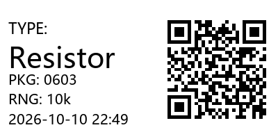
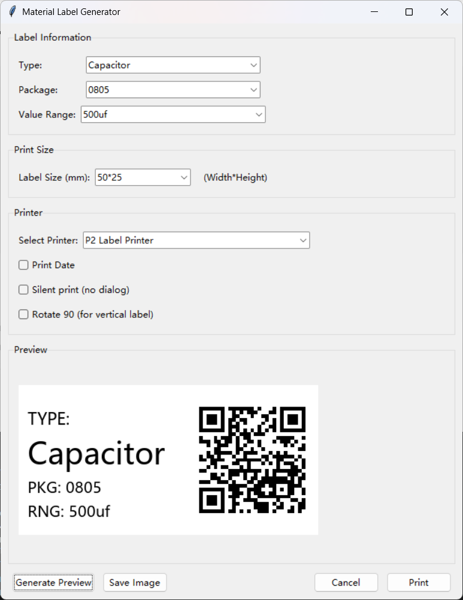

# Material Label Generator

A Python-based material label generator with QR code support and Windows printer integration.

## Features

- **Label Layout**: Left side displays TYPE, PKG (Package), and RNG (Value Range); Right side displays QR code
- **QR Code Content**: Encodes TYPE, PKG, and RANGE information
- **Customizable Size**: Print size from 1mm to 70mm x 70mm
- **Print Date Option**: Optional timestamp on label
- **Printer Support**: Windows printer selection via dropdown
- **Input History**: Custom inputs are saved to `history.ini` and persist across sessions
- **Preview**: Real-time label preview before printing
- **Save Image**: Export label as PNG image

## Preview





## Requirements

```
Pillow
qrcode
pywin32
```

## Usage

```bash
python main.py
```

## Project Structure

```
label_generator/
├── generator/
│   ├── __init__.py
│   └── label.py         # Label generation logic
├── gui/
│   ├── __init__.py
│   └── gui.py           # GUI interface
├── config.py            # History management
├── main.py              # Entry point
└── history.ini          # Auto-generated (user input history)
```

## Print Size

- Minimum: 1mm x 1mm
- Maximum: 70mm x 70mm
- Default: 50mm x 25mm# label_generator
